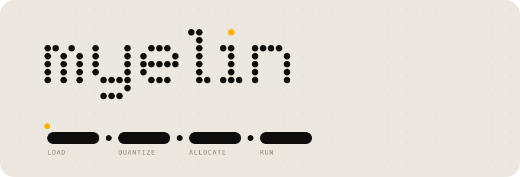

<picture>
  <source media="(prefers-color-scheme: dark)" srcset="readme/hero-dark.svg">
  
</picture>

# myelin

A minimal language and protocol for running local models. Omyelin is the app around it.

Working name. In development, not published yet.

**[Open the site](https://baiehclaca.github.io/myelin-site/)**

Myelin compiles each model into a native binary for the machine it runs on. The compiler sees the whole model graph and removes the parts it does not use. There is no garbage collector and no runtime library. Every kernel compiles to C and to Metal.

Omyelin is the app around the engine, the way Ollama is around llama.cpp. It is pure Python — the standard library, plus a C compiler for Myelin's plans. It can read `~/.ollama/models` (it never writes, converts, or deletes there) and serves `/api/chat`, `/api/generate`, and `/v1/chat/completions`, with streaming.

Runs today: Llama 3.x, Qwen 2.5, Qwen 3. More in progress.

Hardware paths in the current build: x86-64 (Intel AMX, AVX-512 VNNI), ARM64 (NEON SDOT), and Apple GPU (Metal, split per phase). CUDA is designed for, not built.

## measured

Numbers are from SmolLM2-360M-Instruct. The x86 box used 8 threads, median of 7 rounds. Your machine and model will differ.

| measurement | result |
|---|---|
| prompt processing, q8, against llama.cpp's default AMX build | 1.55× |
| prompt, Apple M1 Pro GPU, q4 | 1695 tok/s |
| decode, Apple M1 Pro CPU, q4 | 301 tok/s |
| heap while the model runs | +0 bytes |

A q4 build on the x86 test box (smollm2-360m) produced 846.7 tok/s prefill and 230.7 tok/s generate, with +0 bytes of heap during the run.

## logos

Official marks (SVG and 2048 px PNG) are in [`logos/`](logos/). [Download the pack](https://baiehclaca.github.io/myelin-site/logos/myelin-logos.zip).

The wordmark is lowercase myelin on a 5×9 dot grid. The tittle of the i is phosphor amber. The mark is an axon: three sheath pills and two nodes.

## this repository

Static site served from GitHub Pages (`main`, site root). Source is `index.html`, `styles.css`, `main.js`, and `logos/`. Asset paths are relative so the site works at `/myelin-site/`.

By Teodor Walter Vido, 2026.
